# Class Diagram Smart Taruna

Diagram ini menggambarkan model domain aplikasi yang saat ini diterapkan, berdasarkan `prisma/schema.prisma`. Atribut scalar dan relasi diambil dari metadata Prisma, bukan dari rancangan fitur yang belum dibuat.



## Berkas

- [PDF untuk presentasi atau dicetak](class-diagram.pdf)
- [PNG resolusi tinggi untuk slide](class-diagram.png)
- [SVG yang tetap tajam saat diperbesar](class-diagram.svg)
- [Sumber Mermaid yang dapat diedit](class-diagram.mmd)

## Cara membaca

Setiap kotak adalah kelas domain. Bagian atas berisi nama kelas dan bagian bawah berisi tipe serta nama atribut. Tanda `+` menyatakan atribut model dapat diakses; tanda `?` setelah tipe menandakan nilai boleh `null`. Nama dan tipe mengikuti Prisma, sehingga `DateTime` berarti waktu/tanggal dan `Json` berarti data terstruktur.

Garis adalah asosiasi. Angka di dekat suatu kelas menyatakan jumlah objek kelas itu yang boleh berhubungan dengan satu objek di ujung seberangnya:

- `1`: tepat satu.
- `0..1`: boleh tidak ada, paling banyak satu.
- `0..*`: boleh tidak ada atau lebih dari satu.

Contoh: `User "1" -- "0..*" Attempt` berarti satu pengguna boleh memiliki banyak sesi ujian, sedangkan setiap sesi wajib dimiliki tepat satu pengguna. `Package "0..*" -- "0..*" Tag` berarti satu paket dapat memiliki banyak tag dan satu tag dapat dipakai banyak paket.

Relasi ditampilkan sebagai asosiasi biasa. Aturan hapus berantai pada database tidak otomatis digambarkan sebagai pewarisan atau komposisi UML.

## Tanggung jawab kelas

| Kelas | Tanggung jawab |
| --- | --- |
| User | Akun, peran siswa/admin, dan data profil. |
| SocialLink | Tautan media sosial milik pengguna. |
| Test | Jenis ujian, misalnya SKD atau TPA. |
| Package | Paket/try out, durasi, token ujian, batas percobaan, serta status publikasi. |
| PackagePassingGrade | Ambang kelulusan per kategori soal di dalam paket. |
| Tag | Label pengelompokan paket. |
| Question | Isi soal, tipe jawaban, kunci jawaban isian, toleransi numerik, dan pembahasan. |
| Choice | Opsi jawaban, penanda benar, dan bobot skor opsi. |
| Attempt | Satu sesi pengerjaan: pengguna, paket, urutan acak, waktu, heartbeat, jeda, dan skor akhir. |
| Response | Jawaban serta skor untuk satu soal dalam satu sesi. |
| SecurityEvent | Catatan aktivitas sesi, misalnya perpindahan tab dan pengumpulan otomatis. |

## Detail penting untuk sidang

1. `Admin` dan `Siswa` tidak menjadi subclass. Implementasi memakai satu model `User` dengan atribut `role`; hak akses ditentukan oleh aplikasi.
2. `Attempt` berbeda dari `Package`: paket adalah kumpulan soal yang dapat dipakai berulang, sedangkan attempt adalah kejadian seorang pengguna mengerjakan paket tersebut. `completedAt` bernilai `null` selama sesi belum selesai.
3. `Response` menghubungkan `Attempt` dan `Question`. Kombinasi `(attemptId, questionId)` unik, sehingga satu soal dalam satu sesi mempunyai satu baris jawaban yang diperbarui ketika autosave. `Response.content` menyimpan teks jawaban; tidak ada foreign key langsung ke `Choice`.
4. Satu `Question` mempunyai `0..*` pilihan karena soal isian teks dan numerik tidak membutuhkan opsi. Kunci jawaban isian menggunakan `correctAnswer`; pilihan ganda menggunakan atribut pada `Choice`.
5. Hubungan `Package` ke `Test` memakai `Package.testName` yang merujuk ke `Test.name` yang unik. Sementara `Attempt.testId` merujuk langsung ke `Test.id`, selain menyimpan `packageId`.
6. Kombinasi `(packageId, type)` pada `PackagePassingGrade` unik. `User.username`, `User.email`, `Test.name`, dan `Tag.name` juga unik.
7. Relasi penghapus paket bersifat opsional: satu `Package` dapat memiliki nol atau satu `deletedBy` dan satu pengguna dapat tercatat menghapus banyak paket. Ini catatan penghapusan, bukan kepemilikan paket.
8. `Package` dan `Tag` memiliki relasi banyak-ke-banyak. Prisma mengelola tabel penghubung implisit; diagram domain tidak menambahkan kelas penghubung yang tidak dideklarasikan sebagai model aplikasi.
9. `lastHeartbeatAt` dan `totalPausedMs` pada `Attempt` mendukung pause timer. `questionOrder` dan `choiceOrder` menyimpan urutan acak sesi, bukan membuat salinan soal.
10. Gambar disimpan sebagai alamat/path pada atribut `User.profileImage`, `Question.image`, dan `Question.explanationImage`. File fisik disimpan oleh layanan upload lokal; tidak ada model `Image` atau `Bucket` pada schema.
11. Analitik soal dihitung dari jawaban dan sesi yang sudah selesai. Hasil seperti persentase benar atau status perlu ditinjau tidak memiliki tabel/class persisten tersendiri.

## Mengapa tidak ada method pada model?

Ini UML class diagram pada tingkat model domain yang disimpan aplikasi. Implementasi menggunakan model Prisma, komponen React, fungsi helper, dan route handler Next.js. Karena operasi bisnis tidak dideklarasikan sebagai method kelas model, diagram tidak menambahkan method seperti `User.login()` atau `Attempt.pause()` yang tidak ada di source code.

Operasi aplikasi yang berhubungan dengan model tersebut berada di modul berikut:

| Modul implementasi | Operasi dan model terkait |
| --- | --- |
| `src/app/lib/auth-options.ts` | Autentikasi akun dan peran `User`. |
| `src/app/api/ujian/_attempt.ts` | `saveAttemptAnswer`, `finishAttempt`, `recordAttemptHeartbeat`, `ensureAttemptOpen`; mengelola `Attempt`, `Response`, dan `SecurityEvent`. |
| `src/app/api/ujian/_scoring.ts` | `scoreAnswer`; menilai jawaban berdasarkan `Question` dan `Choice`. |
| `src/app/lib/exam-sweeper.ts` | `sweepExpiredAttempts`; menyelesaikan sesi yang melewati batas waktu server. |
| `src/app/api/admin/analytics/route.ts` | Menghitung analitik dari `User`, `Package`, `Question`, `Attempt`, `Response`, dan `SecurityEvent`. |
| `src/app/lib/local-upload.ts` | `uploadImageLocally`, `readLocalImage`, `deleteLocalImage`; menangani file gambar lokal. |

Untuk menjelaskan diagram secara lisan: "Jenis ujian mempunyai beberapa paket. Setiap paket berisi soal dan ketentuan kelulusan. Pengguna mengerjakan paket melalui sebuah sesi Attempt. Jawaban setiap soal disimpan sebagai Response, sementara aktivitas sesi dicatat sebagai SecurityEvent. Peran admin dan siswa dibedakan oleh atribut role pada User."

## Membuat ulang diagram

Jalankan dari root proyek:

```powershell
node docs/class-diagram/render.cjs
```

Renderer memakai Prisma Client yang sudah terpasang dan Microsoft Edge melalui Playwright pada Windows. Pada sistem lain, Chromium Playwright perlu tersedia. Bila schema berubah, Prisma Client perlu diperbarui terlebih dahulu dengan prosedur proyek yang biasa.

Renderer mengunduh library Mermaid versi tetap ke folder sementara jika belum tersedia, lalu merender diagram secara lokal. Schema dan data aplikasi tidak dikirim ke layanan diagram eksternal. Hasil PDF, SVG, dan PNG dapat dibuka tanpa internet atau menjalankan server aplikasi.
